# 안녕하세요, 김관영입니다 👋

Python API와 React·TypeScript 화면을 구현하고, 요청 처리부터 결과 표시까지 이어지는 흐름을 검증해 온 개발자입니다.
HajaCheck의 FastAPI 보고서 생성 API와 Java/Spring 재검증 API를 구현했으며, 개인 리뷰 감성 분석을 FastAPI·PostgreSQL·Next.js로 이관해 공개 배포했습니다.

- 🌐 포트폴리오: [ketose.vercel.app](https://ketose.vercel.app)
- 🎓 백석대학교 소프트웨어학전공 · K-Digital Training (2024.11 ~ 2025.07)

## Stack

Git/GitHub, Figma, Notion으로 협업합니다. API 연동·화면 상태 관리와 함께 입력·상태·권한에 따른 실패 조건을 테스트하고, 배포 환경의 의존성과 메모리 제약을 확인해 수정했습니다.

## Selected Work

| 프로젝트 | 직접 맡은 일과 확인한 결과 |
| --- | --- |
| [HajaCheck](https://github.com/luma-team-ai/HajaCheck) · 팀 프로젝트 | FastAPI 보고서 API·4개 섹션 생성 체인 구현, 팀원 검증 모듈 연결·재생성 테스트. 별도 Java/Spring API에서 편집 후 구조를 재검증하고 상태·권한 경계를 테스트했습니다. |
| [리뷰 감성 분석](https://github.com/Ketose333/review-sentiment) · 개인 프로젝트 | Streamlit 데모를 FastAPI·PostgreSQL·Next.js로 이관해 Vercel·Modal·Neon에 배포했습니다. 입력 검증·오류 처리·실행 기록을 구현하고 콜드 스타트와 메모리 설정을 비교했습니다. |
| [같이가계](https://github.com/sinisack/ogetherBudget_Project) · 팀 프로젝트 | React/Vite 대시보드·인증 화면과 Spring Boot API 연동을 담당했습니다. WebSocket 이벤트를 화면 상태에 반영했습니다. |

## Projects

<!-- PORTFOLIO:PROJECTS:START -->
| 프로젝트 | 기간 | 설명 |
| --- | --- | --- |
| [U-Net·YOLOv8 기반 시설물 하자 탐지 AI — HajaCheck](https://github.com/luma-team-ai/HajaCheck) | 2026.07.09 ~ 2026.08.07 (4주) | AI 시설물 하자 탐지와 근거 기반 점검 보고서 생성 서비스 |
| [HyperFrame](https://github.com/Ketose333/HyperFrame) | 2026.07.01 ~ 현재 (진행 중) | 드로잉 웨이브테이블 신스 VST3 플러그인 |
| [CNN 기반 음악 무드 분류·추천 AI](https://github.com/Ketose333/music-mood-recs) | 2026.06.25 ~ 2026.07.04 (9일) | CNN 무드 분류와 임베딩 추천을 결합한 Streamlit 앱 |
| [KLUE-BERT 기반 리뷰 감성 분석 AI](https://github.com/Ketose333/review-sentiment) | 2026.06.21 ~ 2026.09.26 (MVP 12일·이관 4일) | 세 모델 감성 분류와 LIME 근거를 제공하는 FastAPI·Next.js 앱 |
| [LangChain LLM 운세 챗봇 — TaeyulBot](https://github.com/Ketose333/TaeyulBot) | 2026.06.12 ~ 2026.08.06 (8주) | 별자리 운세와 LLM 롤플레이 대화를 제공하는 Discord 봇 |
| [OCR 영수증 분석 소비 리포트 — DopaCheck](https://github.com/luma-team-ai/DopaCheck) | 2026.06.10 ~ 2026.06.17 (7일) | 영수증 OCR을 지출 분석과 디톡스 챌린지로 연결한 팀 서비스 |
| [웹 포트폴리오](https://github.com/Ketose333/ketose-portfolio) | 2026.04.25 ~ 2026.05.19 (25일) | 배포 프로젝트와 공통 UI·메타데이터를 관리하는 포트폴리오 모노레포 |
| [WebSocket 실시간 협업 가계부 — 같이가계](https://github.com/sinisack/ogetherBudget_Project) | 2025.10.17 ~ 2025.11.21 (5주) | WebSocket 기반 실시간 협업 가계부 |

### Live

| 프로젝트 | URL |
| --- | --- |
| U-Net·YOLOv8 기반 시설물 하자 탐지 AI — HajaCheck | https://hajacheck.luma200ok.com |
| CNN 기반 음악 무드 분류·추천 AI | https://music-mood-recs.streamlit.app |
| KLUE-BERT 기반 리뷰 감성 분석 AI | https://review-sentiment-web.vercel.app |
| OCR 영수증 분석 소비 리포트 — DopaCheck | https://dopacheck.luma200ok.com |
| 웹 포트폴리오 | https://ketose.vercel.app |
| WebSocket 실시간 협업 가계부 — 같이가계 | https://wizlet-budget.vercel.app |
<!-- PORTFOLIO:PROJECTS:END -->

## Contact

질문이나 협업 제안은 이슈로 남겨주시면 확인 후 답변드립니다.

## GitHub Stats

